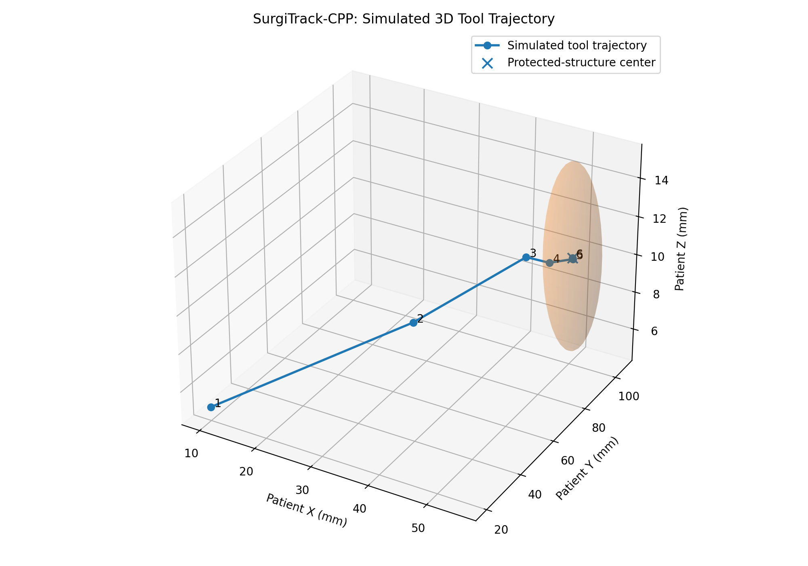
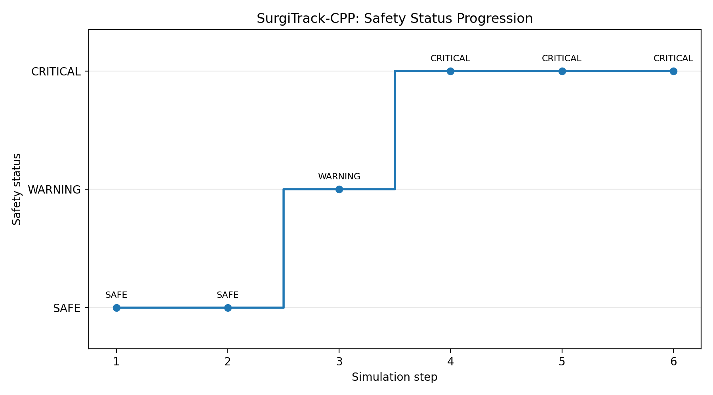
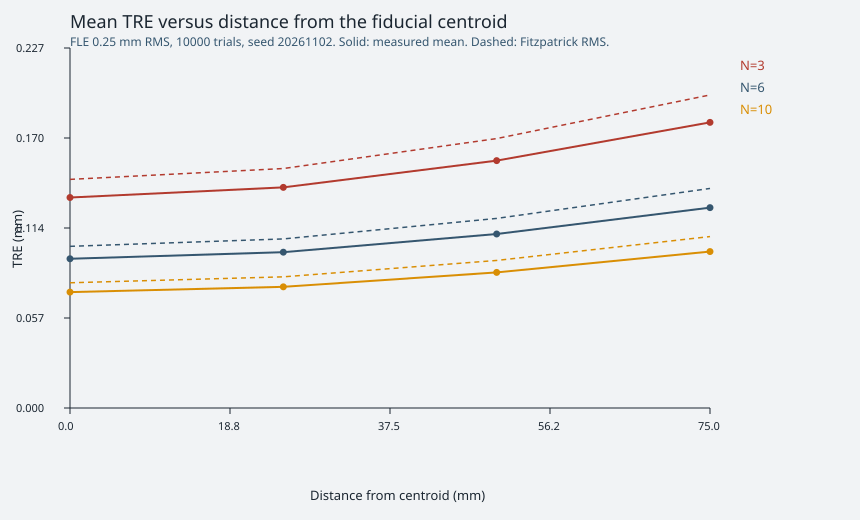
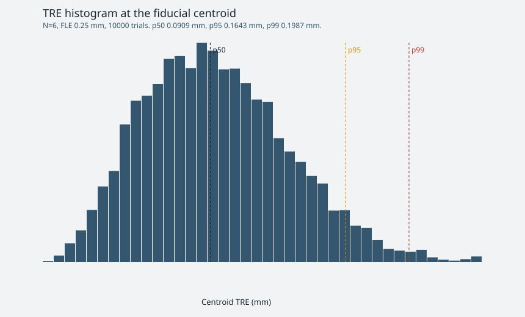

# SurgiTrack-CPP — navigation geometry and rigid registration

A portfolio C++17 project for two educational simulations:

- homogeneous transforms and spherical safety geofences
- point-based rigid registration (Kabsch / Arun) and a Monte Carlo study of FRE and TRE

> **Academic simulation, not a clinical system.** There is no tracker, no patient image, and no surgical use. Every registration number below comes from a run on this machine. Values that were not measured are written as "—".

## Convention

One point is one column of an `Eigen::Matrix3Xd`. Coordinates, translations, FRE, TRE, and FLE are millimetres. Numeric tests use `EXPECT_NEAR` or Eigen `isApprox` with a tolerance.

`registerRigid` maps the moving cloud onto the fixed cloud: `fixed ≈ R * moving + t`, with `det(R) = +1`.

## What the registration module does

The fit follows the Kabsch / Arun SVD in `docs/PLAN.md` section 3.4:

1. Centroids of the two labelled clouds.
2. Cross-covariance `H = Pc * Qcᵀ`.
3. Jacobi SVD `H = U Σ Vᵀ`.
4. `R = V diag(1, 1, det(V Uᵀ)) Uᵀ`, which rejects reflections.
5. `t = centroid_fixed − R * centroid_moving`.
6. FRE is the RMS residual on the fiducials that entered the fit.

The call refuses fewer than 3 points, a size mismatch, non-finite coordinates, a pairwise-distance pattern that is not a rigid motion, and collinear fiducials (`σ₂ < 1e-6 * σ₁`). It warns, and still returns a fit, when `σ₂ < 1e-2 * σ₁` or when the fiducials are coplanar (`σ₃ < 1e-2 * σ₁`).

TRE is the error at targets that were not used as fiducials. The Monte Carlo compares mean TRE² with Fitzpatrick's formula (`docs/PLAN.md` section 3.5):

```text
TRE² ≈ (FLE² / N) * (1 + (1/3) Σ dₖ² / fₖ²)
```

`dₖ` is the target's distance to principal axis k. `fₖ²` is the mean squared distance of the fiducials from that axis. FLE is the 3D RMS of isotropic Gaussian noise added only to the moving fiducials (`σ_axis = FLE / sqrt(3)`).

## Project structure

```text
SurgiTrack-CPP/
├── include/surgitrack/
│   ├── CoordinateTransform.hpp
│   ├── SafetyGeofence.hpp
│   ├── RigidRegistration.hpp
│   ├── RegistrationMetrics.hpp
│   ├── MonteCarloStudy.hpp
│   └── MonteCarloExport.hpp
├── src/
│   ├── CoordinateTransform.cpp
│   ├── SafetyGeofence.cpp
│   ├── RigidRegistration.cpp
│   ├── RegistrationMetrics.cpp
│   ├── MonteCarloStudy.cpp
│   ├── MonteCarloExport.cpp
│   ├── MonteCarloMain.cpp
│   └── main.cpp
├── tests/
│   ├── test_navigation.cpp
│   ├── test_rigid_registration.cpp
│   ├── test_registration_metrics.cpp
│   └── test_monte_carlo_export.cpp
├── results/
│   ├── results.json
│   ├── mc.csv
│   ├── points.json
│   ├── tre_vs_distance.svg
│   ├── tre_histogram_n6_fle0p25.svg
│   └── ctest_release.txt
├── frontend/
├── docs/
│   ├── PLAN.md
│   └── PLAN_2H.md
├── .github/workflows/
│   ├── cpp-ci.yml
│   └── frontend-build.yml
└── CMakeLists.txt
```

## Navigation simulation

The original simulator still transforms a short camera-space trajectory into patient space and evaluates spherical protected zones.

| Status | Meaning |
|---|---|
| `SAFE` | Outside all protected zones |
| `WARNING_APPROACHING` | Inside the warning buffer around a protected zone |
| `CRITICAL_VIOLATION` | Inside a protected zone |

For transform composition, `A.combine(B)` computes `A × B`, so **B is applied first and A second**.

### 3D trajectory



### Safety status progression



The console log from that earlier navigation run is in [`reports/simulation_output.txt`](reports/simulation_output.txt). Those figures illustrate the geofence rules only.

## Build and test

Prerequisites: CMake 3.16+, a C++17 compiler, and network access the first time Eigen, GoogleTest, nlohmann/json, and CLI11 are fetched. This machine used g++ 13.3.0, CMake 3.28.3, and Ninja 1.11.1. The default `c++` on this machine is Clang 18 and could not link `libstdc++`; the commands below select `g++`.

```bash
cmake -S . -B build-ninja -G Ninja -DCMAKE_BUILD_TYPE=Release -DCMAKE_C_COMPILER=gcc -DCMAKE_CXX_COMPILER=g++
cmake --build build-ninja --parallel
ctest --test-dir build-ninja --output-on-failure -C Release
./build-ninja/SurgiTrackApp
./build-ninja/SurgiTrackMonteCarlo --trials 10000 --seed 20261102 --output results
```

Release `ctest` on this tree reported:

```text
100% tests passed, 0 tests failed out of 48
Total Test time (real) =   0.09 sec
```

The full log is [`results/ctest_release.txt`](results/ctest_release.txt). A Debug Ninja build with `-fsanitize=address,undefined` also reported `100% tests passed, 0 tests failed out of 48` (total test time 0.99 s). **Remote CI (2026-11-03):** on PR #2 head commit `bee72e8359999b08b6629789e8e4ad3c5120e7a1`, GitHub Actions passed on Ubuntu 24.04 and Windows Server 2022 (Visual Studio 2022 / MSVC): all 48 CTest tests passed on both platforms. The React Companion Build also passed.

## Monte Carlo results

Command that produced `results/`:

```text
./build-ninja/SurgiTrackMonteCarlo --trials 10000 --seed 20261102 --output results
```

Recorded in `results/results.json`:

| Field | Value |
|---|---|
| generated_at_utc | 2026-11-02T18:25:45Z |
| seed | 20261102 |
| trials per configuration | 10000 |
| OpenMP threads | 4 |
| configurations | 32 (N = 3..10, FLE = 0.1, 0.25, 0.5, 1.0 mm) |
| mc.csv data rows | 320000 |
| units | mm |

A second run with the same command wrote an identical `mc.csv`. Apart from `generated_at_utc`, its `results.json` matched the first. Samples do not depend on the thread count: each trial has its own `std::mt19937_64` seed. Noise is Box–Muller from that generator, not `std::normal_distribution`.

Percentiles are Hyndman–Fan type 7. The median is p50. p5 is the same estimator at probability 0.05 and is the lower edge of the noise-chart band. Tables below use the same 6 decimal places for millimetres and 8 for relative TRE² as the program's summary print. The JSON file keeps the full values.

### Noiseless demo (`results/points.json`)

First 6 reference fiducials, no noise, known pose translation `[15, -8, 6]` mm.

| Quantity | Measured value |
|---|---|
| FRE RMS | 6.370165222705675e-14 mm |
| det(R) | 0.9999999999999981 |
| recovered translation | [14.999999999999996, -8, 6.000000000000007] mm |

### Centroid TRE

Target at the fiducial centroid. `formula rms` is `sqrt(FLE² / N)`. `rel TRE²` is `(mean TRE² − formula) / formula`.

| N | FLE mm | mean | median | p5 | p95 | p99 | rms | formula rms | rel TRE² |
|---:|---:|---:|---:|---:|---:|---:|---:|---:|---:|
| 3 | 0.100000 | 0.053448 | 0.051434 | 0.019572 | 0.094355 | 0.113148 | 0.058103 | 0.057735 | 0.01277337 |
| 3 | 0.250000 | 0.132893 | 0.128505 | 0.049973 | 0.231719 | 0.279983 | 0.144102 | 0.144338 | -0.00325954 |
| 3 | 0.500000 | 0.268462 | 0.259815 | 0.099668 | 0.463917 | 0.557264 | 0.290822 | 0.288675 | 0.01492630 |
| 3 | 1.000000 | 0.528187 | 0.509709 | 0.196035 | 0.923040 | 1.105594 | 0.572938 | 0.577350 | -0.01522779 |
| 4 | 0.100000 | 0.046281 | 0.044522 | 0.016970 | 0.081529 | 0.100056 | 0.050268 | 0.050000 | 0.01076265 |
| 4 | 0.250000 | 0.114470 | 0.110776 | 0.041532 | 0.203313 | 0.241116 | 0.124498 | 0.125000 | -0.00802361 |
| 4 | 0.500000 | 0.230883 | 0.222693 | 0.085578 | 0.402349 | 0.479194 | 0.250386 | 0.250000 | 0.00309074 |
| 4 | 1.000000 | 0.455767 | 0.439862 | 0.166923 | 0.795230 | 0.974637 | 0.495029 | 0.500000 | -0.01978534 |
| 5 | 0.100000 | 0.040835 | 0.039367 | 0.015080 | 0.072113 | 0.085759 | 0.044376 | 0.044721 | -0.01540570 |
| 5 | 0.250000 | 0.102896 | 0.099170 | 0.038024 | 0.180133 | 0.217343 | 0.111815 | 0.111803 | 0.00020122 |
| 5 | 0.500000 | 0.205433 | 0.197958 | 0.075352 | 0.360158 | 0.437853 | 0.223089 | 0.223607 | -0.00462561 |
| 5 | 1.000000 | 0.412899 | 0.398035 | 0.155991 | 0.725566 | 0.881038 | 0.448130 | 0.447214 | 0.00410379 |
| 6 | 0.100000 | 0.037744 | 0.036324 | 0.014180 | 0.065854 | 0.078533 | 0.040901 | 0.040825 | 0.00375468 |
| 6 | 0.250000 | 0.094226 | 0.090885 | 0.035206 | 0.164278 | 0.198701 | 0.102199 | 0.102062 | 0.00267797 |
| 6 | 0.500000 | 0.189460 | 0.183227 | 0.071200 | 0.332189 | 0.394897 | 0.205237 | 0.204124 | 0.01093688 |
| 6 | 1.000000 | 0.377934 | 0.365068 | 0.138928 | 0.659535 | 0.781247 | 0.409988 | 0.408248 | 0.00854079 |
| 7 | 0.100000 | 0.034809 | 0.033477 | 0.012813 | 0.061460 | 0.072929 | 0.037833 | 0.037796 | 0.00192403 |
| 7 | 0.250000 | 0.086916 | 0.083256 | 0.033128 | 0.152427 | 0.183219 | 0.094343 | 0.094491 | -0.00312669 |
| 7 | 0.500000 | 0.173551 | 0.166909 | 0.064773 | 0.308084 | 0.369360 | 0.188754 | 0.188982 | -0.00241831 |
| 7 | 1.000000 | 0.350432 | 0.338804 | 0.131507 | 0.615731 | 0.744905 | 0.380228 | 0.377964 | 0.01201216 |
| 8 | 0.100000 | 0.032554 | 0.031291 | 0.011829 | 0.057301 | 0.069732 | 0.035406 | 0.035355 | 0.00287728 |
| 8 | 0.250000 | 0.080710 | 0.077638 | 0.029632 | 0.142545 | 0.172253 | 0.087738 | 0.088388 | -0.01466368 |
| 8 | 0.500000 | 0.161528 | 0.155202 | 0.059445 | 0.284082 | 0.343234 | 0.175597 | 0.176777 | -0.01330107 |
| 8 | 1.000000 | 0.324733 | 0.311733 | 0.119744 | 0.571133 | 0.681484 | 0.352663 | 0.353553 | -0.00502916 |
| 9 | 0.100000 | 0.030677 | 0.029569 | 0.011239 | 0.053568 | 0.065515 | 0.033362 | 0.033333 | 0.00170635 |
| 9 | 0.250000 | 0.076703 | 0.073910 | 0.028581 | 0.134174 | 0.159854 | 0.083239 | 0.083333 | -0.00227221 |
| 9 | 0.500000 | 0.153833 | 0.148412 | 0.056720 | 0.268147 | 0.326253 | 0.166917 | 0.166667 | 0.00300672 |
| 9 | 1.000000 | 0.306000 | 0.294916 | 0.109624 | 0.538187 | 0.649220 | 0.332717 | 0.333333 | -0.00369677 |
| 10 | 0.100000 | 0.029015 | 0.028099 | 0.010893 | 0.051115 | 0.062363 | 0.031527 | 0.031623 | -0.00603530 |
| 10 | 0.250000 | 0.073180 | 0.070763 | 0.026944 | 0.126475 | 0.153297 | 0.079299 | 0.079057 | 0.00612624 |
| 10 | 0.500000 | 0.145295 | 0.139648 | 0.053319 | 0.255235 | 0.306839 | 0.157992 | 0.158114 | -0.00154628 |
| 10 | 1.000000 | 0.290262 | 0.279695 | 0.109809 | 0.508692 | 0.611656 | 0.314950 | 0.316228 | -0.00806551 |
Across all 128 target rows (4 distances × 32 configurations), the signed relative error of mean TRE² ranged from -0.02578169210530773 to 0.017870869252205216. The program printed `max_abs_relative_error_tre2: 0.02578169`. That is inside the 5% band in section 3.5 of the plan.

Sibson's check on the same run, `⟨FRE²⟩ ≈ (1 − 2/N) ⟨FLE²⟩`, had signed relative errors from -0.008580655236152443 to 0.014048852282870448.

On this run, at FLE 0.25 mm, mean TRE increased with distance from the centroid for every N from 3 to 10. At the centroid with N = 6, mean TRE increased with FLE. At FLE 0.25 mm, centroid mean TRE decreased as N went from 3 to 10.

### N = 6, TRE against distance

| FLE mm | distance mm | mean | p5 | p95 | formula rms | rel TRE² |
|---:|---:|---:|---:|---:|---:|---:|
| 0.100000 | 0 | 0.037744 | 0.014180 | 0.065854 | 0.040825 | 0.00375468 |
| 0.100000 | 25 | 0.039363 | 0.014658 | 0.068731 | 0.042698 | -0.00045743 |
| 0.100000 | 50 | 0.043948 | 0.016296 | 0.077265 | 0.047878 | -0.00414353 |
| 0.100000 | 75 | 0.050597 | 0.018251 | 0.091052 | 0.055447 | -0.00641927 |
| 0.250000 | 0 | 0.094226 | 0.035206 | 0.164278 | 0.102062 | 0.00267797 |
| 0.250000 | 25 | 0.098376 | 0.036805 | 0.171233 | 0.106744 | -0.00004611 |
| 0.250000 | 50 | 0.109863 | 0.041156 | 0.192579 | 0.119696 | -0.00456733 |
| 0.250000 | 75 | 0.126500 | 0.045911 | 0.226223 | 0.138618 | -0.00868267 |
| 0.500000 | 0 | 0.189460 | 0.071200 | 0.332189 | 0.204124 | 0.01093688 |
| 0.500000 | 25 | 0.198332 | 0.073723 | 0.345959 | 0.213488 | 0.01480946 |
| 0.500000 | 50 | 0.222042 | 0.082071 | 0.394198 | 0.239391 | 0.01711662 |
| 0.500000 | 75 | 0.256029 | 0.091999 | 0.462632 | 0.277237 | 0.01787087 |
| 1.000000 | 0 | 0.377934 | 0.138928 | 0.659535 | 0.408248 | 0.00854079 |
| 1.000000 | 25 | 0.394531 | 0.148825 | 0.691579 | 0.426976 | 0.00473869 |
| 1.000000 | 50 | 0.441269 | 0.164301 | 0.773619 | 0.478783 | 0.00138779 |
| 1.000000 | 75 | 0.508782 | 0.186719 | 0.904273 | 0.554473 | -0.00069562 |

### Figures from that run

Mean TRE against distance at FLE 0.25 mm. Solid lines are the measured means. Dashed lines are the Fitzpatrick RMS.



Centroid TRE histogram for N = 6 and FLE 0.25 mm, with p50, p95, and p99 from the same samples.



## Frontend

`frontend/` is a React/Vite companion. It keeps the synthetic safety-geofence view and adds pages that load `results/results.json`, `results/points.json`, `results/mc.csv`, and `results/ctest_release.txt`. The Monte Carlo page reads `p5_tre_mm` and `p95_tre_mm` from that JSON. A missing quantile stays —. `@react-three/fiber` stays on the 8.x line for React 18. Build notes are in `frontend/README.md`.

## Limitations

- Educational geometry only. No optical tracker, no DICOM, no robot, no real-time claim, no clinical validation.
- Fiducials are a fixed synthetic layout inside a 100 mm box. Targets lie on the direction `(1, 1, 1)` at 0, 25, 50, and 75 mm from the centroid of the subset in use.
- FLE is isotropic and applied to one cloud. Fitzpatrick's expression is a small-noise approximation; this run's largest absolute relative TRE² gap was the printed `0.02578169`.
- FRE on the fiducials is not a substitute for TRE. The study reports both.
- `results.json` and `points.json` are written with nlohmann/json 3.11.3. The Monte Carlo program parses `--trials`, `--seed`, and `--output` with CLI11 2.4.2.
- GCC builds with `-Wall -Wextra -Wpedantic -Werror`. The MSVC CI build uses `/W4 /permissive-` without `/WX`; that configuration was compiled and tested by GitHub Actions on Windows.
- Remote GitHub Actions status for PR #2 head `bee72e8` (2026-11-03): C++ CI passed on Ubuntu 24.04 and Windows Server 2022; React Companion Build passed.
